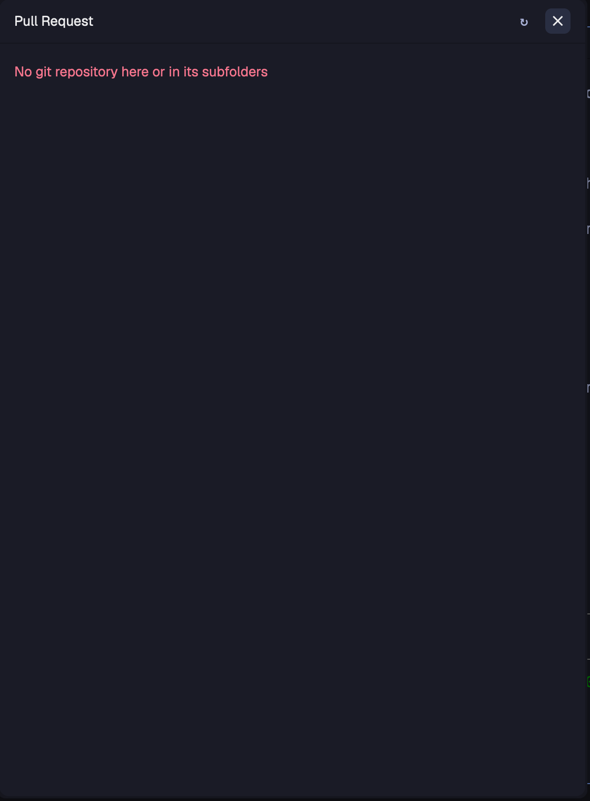

# herdr-pr

A [Herdr](https://herdr.dev) mod that shows the GitHub pull request of the branch you are on:
checks, changed files with their diff, approval, reviewers, assignees and preview links. Merge,
auto-merge, ready for review and make draft are one confirm click away. On a branch without a
pull request it lists your open pull requests across the repositories beside it.



## Install

In Herdr, ask your agent:

> Add the mod from https://github.com/I2olanD/herdr-pr

By hand: copy `mods/pull-request/` to `~/.config/herdr-app/mods/` and merge `keys.json` into
`~/.config/herdr-app/keys.json`.

Needs the [GitHub CLI](https://cli.github.com) (`gh auth login`).

## Use

`cmd-shift-r` opens and closes the dialog. To use another key, change it in your
`~/.config/herdr-app/keys.json`:

```json
{ "global": { "cmd-shift-r": "mod.open:pull-request" } }
```

When the focused terminal runs Claude Code, the dialog follows the folder the Claude session
works in, so a session that moved into a worktree shows that worktree's pull request.

## Preview links

If your CI posts preview deployments as a pull request comment, the dialog shows them as
chips. The comment needs a marker and a markdown table:

```markdown
<!-- herdr-pr-preview -->
| Resource | Link |
|---|---|
| App | [open](https://pr-123.example.com) |
| Storybook | Building |

Built for commit `abc1234`.
```

Rows with a link become a chip that opens it; rows without one show their text. A commit in
backticks marks the preview as stale once the branch has newer commits.

To match a marker your CI already writes, create
`~/.config/herdr-app/mods/pull-request/settings.json`:

```json
{ "previewMarker": "<!-- my-preview-links -->" }
```

## What it runs

`gh`, `git`, `find`, `pgrep`, `tail`, `hc get` and `open`. It reads Claude Code's session files
in `~/.claude` to find the session's folder. It writes nothing.

## License

MIT
