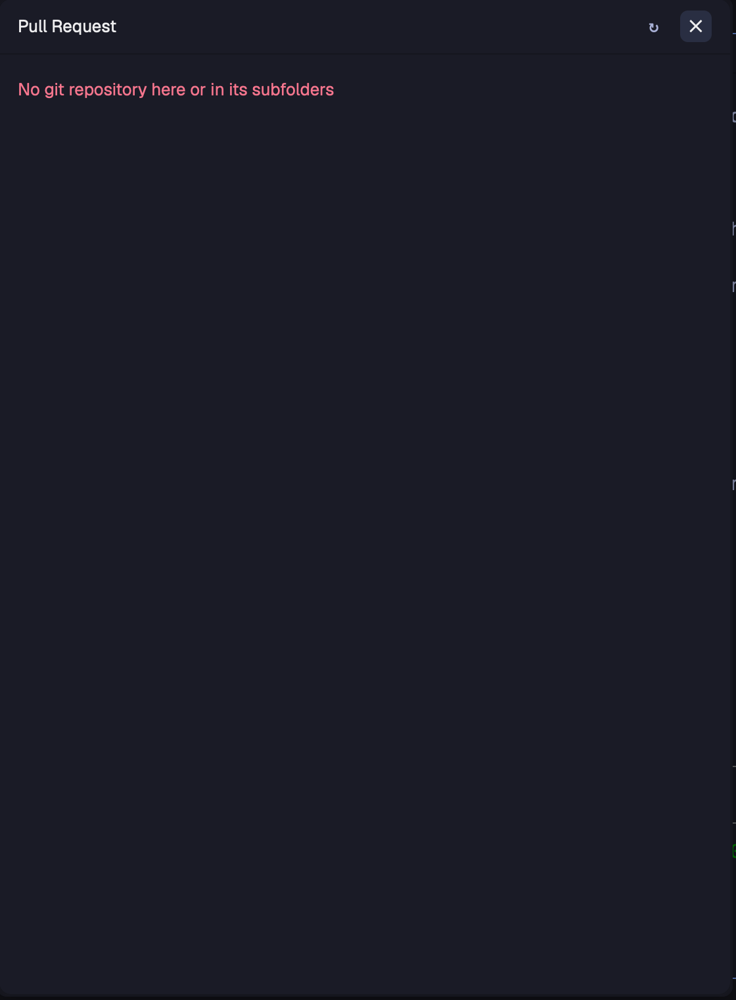

# Pull Request

A dialog that shows the GitHub pull request of the focused terminal's branch: its checks, its
changed files with their diff, approval, reviewers and assignees, and preview links posted by
CI. From the footer you merge it, turn auto-merge on or off, mark it ready for review or turn
it back into a draft. On a branch without a pull request it lists your open pull requests in
the repositories beside it.

## What you see

A dialog 560×760 (`mod.json` overlay), rounded 10, `theme().background`, 1px `border`.
Text 13px `foreground`. Top to bottom:

1. **Header**, 42px, bottom border: on a pull request a `←` button (24px, tooltip "All your
   pull requests"), "Pull Request" semibold, then `repo · branch` in `dim` 11.5px,
   truncated; at the right `↻` (refresh) and, in a dialog, `✕` (close).
2. **Progress bar**, 2px: a 90px `accent` bar loops left to right while anything loads and
   fades out (160ms) when idle.
3. **Content**, fading in over 200ms whenever what it shows changes:
   - **Detail** of one pull request:
     - `#123`, a state badge (Open `ansi2`, Draft `dim`, Merged `ansi5`, Closed `ansi1`;
       10.5px, 1px border in the same color), at the right "GitHub ↗".
     - the title, semibold, wrapping.
     - `base ← head` in `dim`, then `+additions` (`git_add`) and `−deletions` (`git_delete`).
     - while open, the merge state: Ready to merge (`ansi2`), Ready to merge · some checks
       failed, Blocked · required checks or reviews missing, Branch is behind its base
       (`ansi3`), Merge conflicts (`ansi1`), Checking mergeability… (`dim`), then
       "· Auto-merge on" in `accent`.
     - three label rows (label 64px wide in `dim`): **Approval** (Approved `ansi2`,
       Changes requested `ansi1`, Review required `ansi3`; without a review rule "N
       approvals" or "No approval yet"), **Reviewers** (`✓` approved, `✕` changes
       requested, `◦` commented, `–` dismissed, `○` requested and not reviewed yet, then the
       login or team name), **Assignees** (logins, or "None").
     - **Preview**, only when a comment holds the preview marker: "Preview" in `dim`, "· built
       for abc1234, not the latest commit" in `ansi3` when the comment names an older commit,
       then one chip per table row: a link chip `name ↗` (24px, bordered, tooltip the URL,
       opens it), or a grey `name · note` chip with a spinner when the note says build,
       deploy, pending or progress.
     - tabs **Checks N** and **Files N**, at the right "2 failed · 1 pending · 9 passed"
       in `ansi1`/`ansi3`/`ansi2`.
     - Checks: 28px rows, failed first, then pending, passed, skipped: a mark (`✓` `ansi2`,
       `✕` `ansi1`, `–` `dim`, pending a spinning `workspace-chrome/spinner.svg` in `ansi3`),
       the name, the workflow in `dim` at the right. A click opens the check's page.
     - Files: a list up to 200px tall (`A`/`M`/`D`/`R` in git colors, folder `dim`, name,
       `+n −n`); picking one shows its diff below in the terminal font at 11px: 20px rows,
       line numbers, added lines on `diff_add`, removed on `diff_delete`, hunk headers on
       `raised`, scrolling both ways in a virtual list.
   - **List** of your open pull requests: "Your open pull requests" (or "No pull request
     for <branch> · your open pull requests"), then a card per pull request: `repo #n`,
     the head branch, the local worktree folder as a chip when one has it checked out; below,
     the worst check mark, the title, "Draft", and the approval in its color. Cards fade in
     one after another (30ms apart). A click opens the detail.
   - **Skeletons** while loading: pulsing `raised` bones shaped like the detail or the list.
4. **Footer**, while the pull request is open, top border: the merge method (cycles through
   the methods the repository allows), then Make draft, Enable/Disable auto-merge, Merge
   (solid). A draft shows only Ready for review. A message from a failed action shows in
   `ansi1` above it.

## How it behaves

- Opening the dialog reads the focused terminal. When that terminal runs Claude Code, it uses
  the folder the Claude session works in (from `~/.claude/sessions/<pid>.json` and the last
  `cwd` of `~/.claude/projects/*/<session>.jsonl`), so a session that moved into a worktree
  is followed. Otherwise the terminal's own folder.
- In a repository on a branch with a pull request: the detail. On `main`/`master`, on a
  branch without one, or outside a repository: the list, built from every repository one
  level below the folder (its parent when the folder is a repository; when the folder has
  none, the nearest folder above it that has). Repositories are grouped by their GitHub
  `origin`, so worktrees of one repository list its pull requests once.
- While open it refreshes every 30 s; `↻` refreshes now. The diff loads only when Files is
  opened and is kept while the head commit is the same.
- Each action asks for a second click: the button turns `ansi3` and reads "Confirm: Merge".
  While it runs it shows a braille spinner and "Working…", then the pull request reloads.
- `←` goes to the list from any pull request; picking one there opens it without reading the
  focused terminal again.
- `cmd-shift-r` (from `keys.json`) opens and closes the dialog; Esc closes it.

## Built from

- `mods/pull-request/main.js`, a `View`; `mod.json` `{"place": "none", "overlay": {"width":
  560, "height": 760}}`; `keys.json` binds `mod.open:pull-request`.
- `herdr`: `spaces`, `panes`, `focused`, `exec`, `hc`, `home`, `readTextFile`, `theme`,
  `settings`, `props`, `closeOverlay`. `gpui-base`: `v_flex`, `h_flex`, `Scrollbar`,
  `v_virtual_list`.
- Programs: `gh` (`pr view --json`, `pr list --author @me`, `pr diff`, `pr merge`,
  `pr ready`, `repo view`), `git` (`rev-parse`, `remote get-url`), `find`, `pgrep`, `tail`,
  `hc get <terminal> --json` for the terminal's process, `open` for links.
- Shipped art: `mods/workspace-chrome/spinner.svg`. Animations are native: `.loop()`,
  `.spin()`, `.transition()`, `.frames()`.
- Settings: optional `mods/pull-request/settings.json` `{"previewMarker": "<!-- my-marker -->"}`.
  Default marker `<!-- herdr-pr-preview -->`.

## Watch out

- The Claude session lookup reads Claude Code's own files, which are not a public interface.
  When they change it falls back to the terminal's folder.
- `gh` must be signed in. It is looked up in `/opt/homebrew/bin`, `/usr/local/bin`,
  `~/.local/bin`, then the login shell's PATH.
- The preview comment is the newest pull request comment containing the marker. Rows are
  markdown table rows `| name | [label](url) |` or `| name | note |`; the header row (the one
  above `|---|`) is skipped; the first backticked 7–40 character hex string is taken as the
  commit it was built for.
- Only GitHub remotes are recognised (`github.com` in `origin`).
- On another machine the terminal's folder is used; the Claude lookup runs only locally.
- Each opening is a fresh dialog, so it reads the focused terminal every time.

## Done when

- `herdr-app check mods/pull-request` passes.
- In a repository on a branch with an open pull request, `cmd-shift-r` shows its title,
  checks, approval and reviewers; Files shows a diff for a picked file.
- On `main` it lists your open pull requests in the repositories beside it; `←` from a
  detail returns to that list.
- A pull request comment with the marker and a table row `| App | [open](https://example.com) |`
  shows an "App ↗" chip that opens the URL.
- Merge, auto-merge, ready and draft each need two clicks and reload the pull request.
